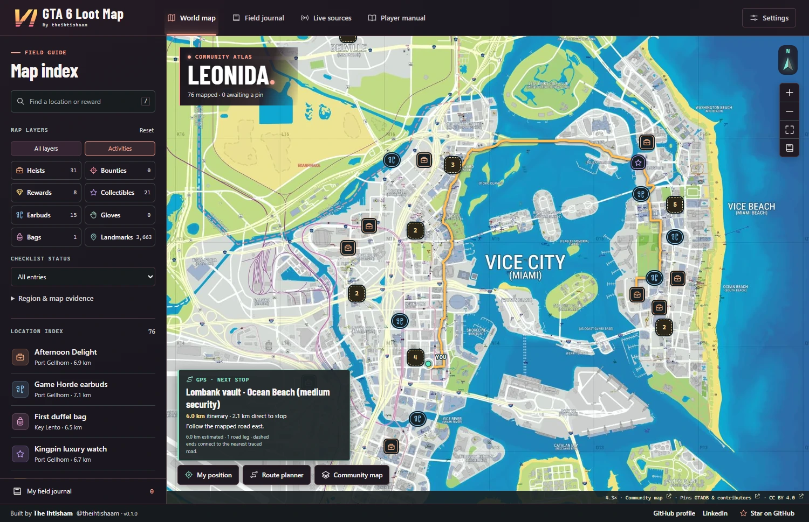

# GTA 6 Loot Map

**By theihtishaam · The Ihtisham · v0.1.0**

An open-source GTA 6 interactive map and loot tracker. Place your character on the map of Leonida, see how far away a reward is, plan a route, and mark what you collected. Discovery runs without an AI model. The installed maps, journal, routes and exports work offline.

The preview uses community cartography by YANIS, GTADB and contributors, adapted under CC BY 4.0. [Map credits](docs/MAP-DATA.md) · [GitHub profile](https://github.com/theihtishaam) · [LinkedIn profile](https://www.linkedin.com/in/ihtishamdeveloper/) · [Star this repository](https://github.com/theihtishaam/GTA-6-Interactive-Map-and-Loot-Tracker)

## Start the app

Download and extract the [v0.1.0 source package](https://github.com/theihtishaam/GTA-6-Interactive-Map-and-Loot-Tracker/releases/tag/v0.1.0), or clone this repository. [First-session walkthrough and release notes](docs/RELEASE-0.1.0.md)

On Windows, double-click **Start Atlas.cmd**. On Windows, macOS or Linux with Python 3.10 or newer:

    python launch_atlas.py

The launcher opens [the local atlas](http://127.0.0.1:8765/). On first launch it fetches pinned copies of the published game map and Rockstar poster for local use. An unavailable download falls back to the bundled community map. For an offline start with the bundled or previously installed layers, use the following command.

    python launch_atlas.py --bundled-only

Start with **Player manual** for a seven-chapter walkthrough. Use **My position** to place your character, **Route planner** for directions, **Field journal** for exports and **Live sources → Bounty Watch** to review community findings. The map-style control beside Route planner offers map layers, dark mode and high contrast.

For a server without a browser window, run the following in the project directory. The server stays available while this process runs. It catches up on overdue checks after a restart.

    python launch_atlas.py --no-open

On Windows, optionally run the following in PowerShell to start the local discovery server after each sign-in without opening a browser. The second command removes that setting.

    .\tools\WindowsStartup.ps1
    .\tools\WindowsStartup.ps1 -Remove

## Find and track a location

1. Select a layer such as **Heists** or **Earbuds**. Only matching activity pins remain and glow. Select **Landmarks** to filter buildings by type, or **All layers** to search everything. Type a name, region, source ID or building type in the index. Press **/** to focus search.
2. Click a pin or a search result to see the location, source and available steps. Overlapping activities open a list. The map highlights the selected location. Coordinates from a screenshot, a community venue and an area report have different evidence labels.
3. Choose **Mark complete**. Use the checklist filter to see completed or remaining entries. Empty categories have a shortcut for recording a personal pin. Each player pin can include a reward note and completion steps.
4. In **Field journal**, export your filtered list as CSV or loot JSON. Loot JSON retains the coordinate reference, provenance, evidence and steps. A separate journal backup includes personal pins, progress and routes. Importing merges pins and completion records and restores the routes in the backup.

The 3,663 positioned landmark records include buildings, shops, transport and natural features. There are 76 unique sourced activity guides, including 22 bank jobs, seven payday jobs, 15 electronics retailers and all ten meditation sites. The meditation checklist covers 18 actions. Some community buildings have only a counterpart name or source number. Coverage varies by category. A discovery without a usable position stays in the index. [Guide research](docs/PLAYER.md) · [Meditation evidence](docs/COLLECTIBLES.md) · [Activity pins](docs/ACTIVITY-PINS.md) · [Map data](docs/MAP-DATA.md)

The **Export center** builds a single-file, printable HTML field pack with an embedded community map, optional route, checklist, steps and evidence links. Choose the current map filters, all activities, bounties, completed entries, personal pins or the entire atlas. CSV includes game-grid coordinates. JSON preserves provenance and can include the route. Use a journal backup when moving editable progress to another browser.

Open a marker and choose **Share a field card** to save one location, its neighborhood map and instructions for another player. Your route is included only if you select it. In **Map appearance**, choose **Vice Neon**, **Ocean Drive** or **Field Gold** and adjust marker glow. Players who prefer reduced motion retain a static highlight.

## Navigate

Choose **My position**, then click where your character stands on the game map. The **YOU** marker is your starting point. Open an activity to read its direct distance and compass direction. **Route here** shows the next stop, estimated itinerary distance and a direction cue. **My position → Nearby activities** lists unfinished activities in distance order. Move your point after travelling, or use the optional screenshot and live-coordinate inputs.

Set your starting point from a place’s detail panel, by clicking the map, or by entering the game’s X/Y grid. Choose **Route here** on a destination. Use Route planner to see estimated distance, directional cues, ordered stops and the complete route. **Reached first stop** advances the itinerary. Drag and pinch, use the wheel, or use arrow keys and zoom controls on the focused map.

A solid line follows a connected trace of the road artwork. Dashed ends connect the marker to the road. A disconnected road, an offshore point, or inaccessible terrain yields a labeled direct bearing. Turn cues follow the shape of the trace. The graph cannot establish one-way rules, lane choices, locked interiors or mission-dependent barriers. [Navigation method and checks](docs/NAVIGATION.md)

**Locate from screenshot** matches a selected GTA VI pause-map image on this computer. Click your player arrow in the preview. This feature requires the installed in-game map and the optional image-matching libraries. Install them with the Python interpreter used to launch the server:

    python -m pip install numpy opencv-python-headless

**Follow local coordinate feed** accepts position updates from an existing local integration. It is opt-in and polls only an open, visible tab. The atlas needs an external coordinate source for continuous tracking on a stock console. The manual and screenshot modes work without a telemetry adapter. Reaching a route stop on a live feed advances the itinerary within a 12-unit map radius. [Local API](docs/API.md)

## Discovery and cost

General discovery and Bounty Watch each default to 24 hours. Choose **6, 12 or 24 hours** independently or use **Check now**. Closing the tab keeps the server’s schedules running. An overdue check runs at the next launch. Each feed shows its last result.

The built-in sources include public GitHub issues, community syndication feeds, and gameplay publications. The importer checks game, date, topic and location evidence, retains source links, and deduplicates by report ID. An explicit unique venue can receive an approximate pin. Broader reports stay searchable. The bundled map revision and researched guides are versioned separately from the discovery cache.

General discovery also searches for new public publishers, locates their feeds, and ranks them using recent qualifying reports. Bounty Watch checks seven automatic sources and provides five additional manual community links. Supported source screenshots and article previews are cached locally with attribution. Submit discoveries through the repository’s location issue template. [Source discovery](docs/RESOURCE-DISCOVERY.md) · [Bounty coverage](docs/API.md) · [Report a location](https://github.com/theihtishaam/GTA-6-Interactive-Map-and-Loot-Tracker/issues/new?template=location.md)

**Ollama Cloud** offers a live model picker. Its current published pricing meters cloud tokens. The picker suggests **gpt-oss:20b** for short extraction tasks when available and requires consent before enabling metered inference. For free hosted inference choose **OpenRouter → openrouter/free**. Local Ollama, OpenCode Console and compatible custom endpoints are also supported. [Model research and limits](docs/MODELS.md) · [Ollama pricing](https://ollama.com/pricing) · [OpenRouter free router](https://openrouter.ai/openrouter/free)

Inference is off until enabled. At most one new or changed eligible report per refresh is sent for enrichment. A model can suggest a short source-backed step or a named venue present in the excerpt. The server checks the literal evidence and obtains coordinates from the catalogue. Remote provider keys stay in process memory and must be reentered after a server restart. The no-model mode uses zero inference credits. External providers determine free-tier quotas and charges.

## Votes

Each entry shows Yes/No votes, total ballots, and the percentage positive. A second click on the same choice withdraws it. Replacing a choice updates the existing ballot. Zero ballots display **No votes yet**. A source’s GitHub reactions, when supplied, appear separately. Votes describe player feedback and do not verify a coordinate.

By default, ballots are stored in this atlas’s SQLite database. To share totals across installations, a community operator can run the included service on an existing HTTPS host:

    python community_votes.py --port 8766

Reverse-proxy only the vote endpoint to this loopback port. Set the HTTPS origin in **public/community.json** on installations that should use it, then reload the app. The optional service accepts the default atlas origins on port 8765. Use its repeatable `--origin` option for another trusted frontend origin. The service stores anonymous browser ballot IDs. Clearing browser storage creates a new ID, so totals are advisory. No public voting service is configured by default.

## Data, development and verification

The Python server and browser modules require no npm build, external tile service or hosted database. The optional GTADB street-map layer can be built locally with Pillow. The following installs all optional map images from the documented pinned sources:

    python -m pip install Pillow
    python tools/install_local_maps.py

Private runtime data lives in **.atlas/**. The distributed code is MIT licensed. GTADB-derived cartography and data retain their CC BY 4.0 attribution. Barlow Condensed uses the SIL Open Font License. The separately downloaded game images remain with their rights holders. This is an independent fan project. [Software license](LICENSE) · [Data credits](docs/MAP-DATA.md) · [Font license](public/fonts/OFL.txt)

Run the integration and data tests with Python, Pillow and NumPy/OpenCV installed. Node is used only by the optional routing test. The independent player walkthrough uses Playwright and a disposable Chrome context.

    python -m unittest discover -s tests -p "test_*.py"
    python tests/player_guides_test.py
    node tests/player_routing.mjs
    python tests/player_walkthrough.py --installed-layers
    python tests/player_gps.py

[Research and implementation plan](docs/RESEARCH-AND-PLAN.md) · [Navigation coverage](docs/NAVIGATION.md) · [Developer API](docs/API.md)

