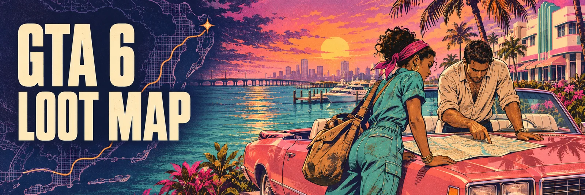

# GTA 6 Loot Map

[](https://npm-stat.com/charts.html?package=gta6-loot-map&from=2026-11-21)
[](https://github.com/theihtishaam)


An open-source GTA VI companion by **The Ihtisham**. Pick a reward, put your character on the map, and plot a route across Leonida. Keep your mission checklist on your own computer. [@theihtishaam on GitHub](https://github.com/theihtishaam) · [Star the project](https://github.com/theihtishaam/GTA-6-Interactive-Map-and-Loot-Tracker) · [LinkedIn](https://www.linkedin.com/in/ihtishamdeveloper/)

**176 mission entries · 88 mission start waypoints · 76 loot and activity guides · 3,663 landmarks.** The bundled map, routes and journal work offline. Leave the local server running to check public sources for new missions, rewards and bounties **every 24 hours**. When a report identifies a location, the atlas pins it automatically. [Mission coverage](https://github.com/theihtishaam/GTA-6-Interactive-Map-and-Loot-Tracker/blob/v0.1.3/docs/MISSIONS.md) · [How discovery works](#4-check-for-new-finds)

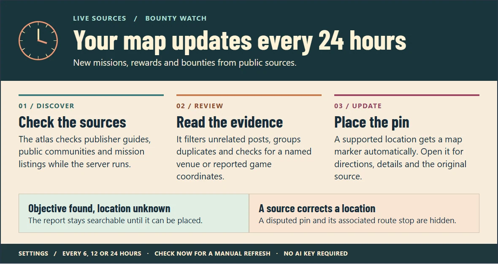

## 1. Install and open the map

### Quick start with npm

With **Node.js 22 or newer**, open a terminal and run this command. If npm asks to install the package on first launch, enter **y**. [Get Node.js](https://nodejs.org/en/download) · [View the npm package](https://www.npmjs.com/package/gta6-loot-map)

```sh
npx gta6-loot-map
```

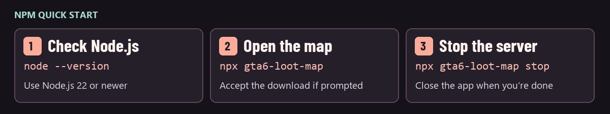

The map opens in your browser. If it doesn’t, copy the local URL printed in the terminal. The launcher normally uses port 8765 and selects an available port if needed. Keep the server running while you play. The launcher can set up checksum-verified portable Python on supported Windows, macOS and Linux systems. [Supported platforms](https://github.com/theihtishaam/GTA-6-Interactive-Map-and-Loot-Tracker/blob/v0.1.3/docs/PORTABLE-RUNTIME.md)

If you prefer to install the command once and use it again from any folder:

```sh
npm install -g gta6-loot-map
gta6-loot-map
gta6-loot-map status
gta6-loot-map stop
```

Use `npx gta6-loot-map status` or `npx gta6-loot-map stop` if you started with npx. To start again, run `npx gta6-loot-map` or the installed `gta6-loot-map` command. The npm launcher keeps its local data outside the installed package. See [advanced setup](https://github.com/theihtishaam/GTA-6-Interactive-Map-and-Loot-Tracker/blob/v0.1.3/docs/ADVANCED.md) for Python requirements and command options.

### Windows ZIP alternative

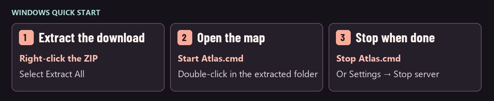

1. Download the [v0.1.3 Windows ZIP](https://github.com/theihtishaam/GTA-6-Interactive-Map-and-Loot-Tracker/releases/download/v0.1.3/GTA-6-Interactive-Map-and-Loot-Tracker-v0.1.3.zip). Right-click it in File Explorer, choose **Extract All**, and open the extracted folder.
2. Double-click **Start Atlas.cmd**. It uses installed Python 3.10 or newer or downloads a verified portable Python 3.14.10 to the app’s `.atlas` folder. The first download needs internet access. This path needs no Node.js or npm.
3. Keep the launcher window open. Double-click **Stop Atlas.cmd** when you’re done. Starting again from the same extracted folder reopens the running map.

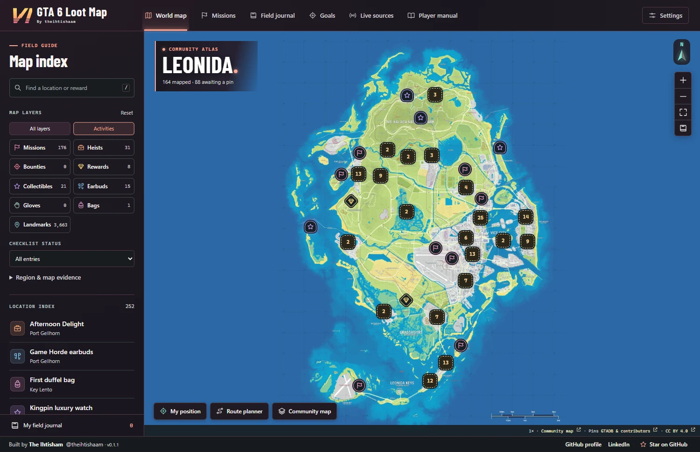

*On a small screen, select **Map index** to open search and filters.*

For either installation, you can also open **Settings**, scroll to **Local server**, and click **Stop server**. Closing the browser tab leaves scheduled checks running. After you stop, run your npm start command again or double-click **Start Atlas.cmd** in the extracted ZIP folder to resume checks.

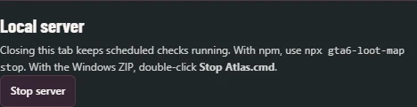

## 2. Pick a first stop


| Look for | Where to start | What you get or pay in-game |
| --- | --- | --- |
| Afternoon Delight | In Chapter 2, progress past **Coffee Break** and wait for Vicki’s call. Search **Afternoon Delight** for the Delights venue in Port Gellhorn. | **GTA$10,000** via BuckMe the following in-game day. [Walkthrough](https://www.powerpyx.com/gta-6-afternoon-delight-rob-vickis-boss-walkthrough/) |
| First duffel bag | Open the **Lab Fees** build and follow Jason’s objective. | Pick up the bag during the mission. [Walkthrough](https://www.powerpyx.com/gta-6-lab-fees-collect-brians-rent-walkthrough/) |
| Earbuds | Select **Earbuds** and open **Game Horde**. Choose which character will make the purchase. | Check the price in the in-game shop. Jason and Lucia have separate audio gear. [Headphone guide](https://www.gamesradar.com/games/grand-theft-auto/gta-6-headphones-music-radio-podcasts-how-to-use/) |

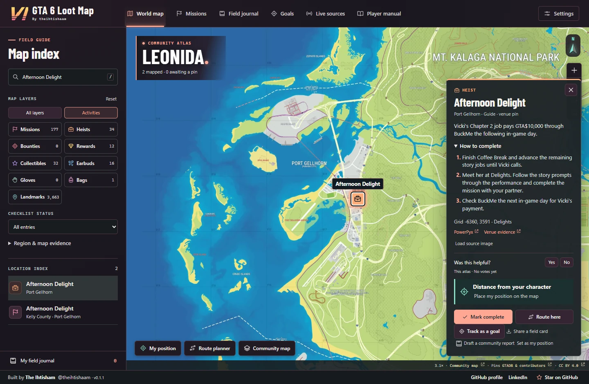

1. In **World map**, select a category such as **Collectibles** or **Earbuds**. You can also type an item name or region in the search box.
2. Click a result or pin. Read **How to complete** and the source before travelling. A venue pin can lead you to the right building. A map-marker pin follows the in-game marker, so use your game’s prompt to find the interaction.
3. When you finish that location in GTA 6, select **Mark complete**. The checklist filter lets you hide completed entries.

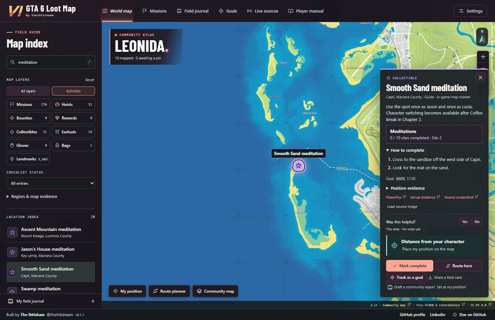

*Try the search term **meditation**. The atlas includes all ten documented sites. Jason’s House is available in Chapter 1 only.* [Meditation evidence](https://github.com/theihtishaam/GTA-6-Interactive-Map-and-Loot-Tracker/blob/v0.1.3/docs/COLLECTIBLES.md)

## Mission builds and goals

Open **Missions** and search by title, quest giver or starting area. Select the result to open its **Mission build**. Read the unlock requirements, tick objectives as you play, then mark the mission complete. **Route to start** appears when the atlas has a supported starting position. A mission that starts on a phone call can still have a complete walkthrough.

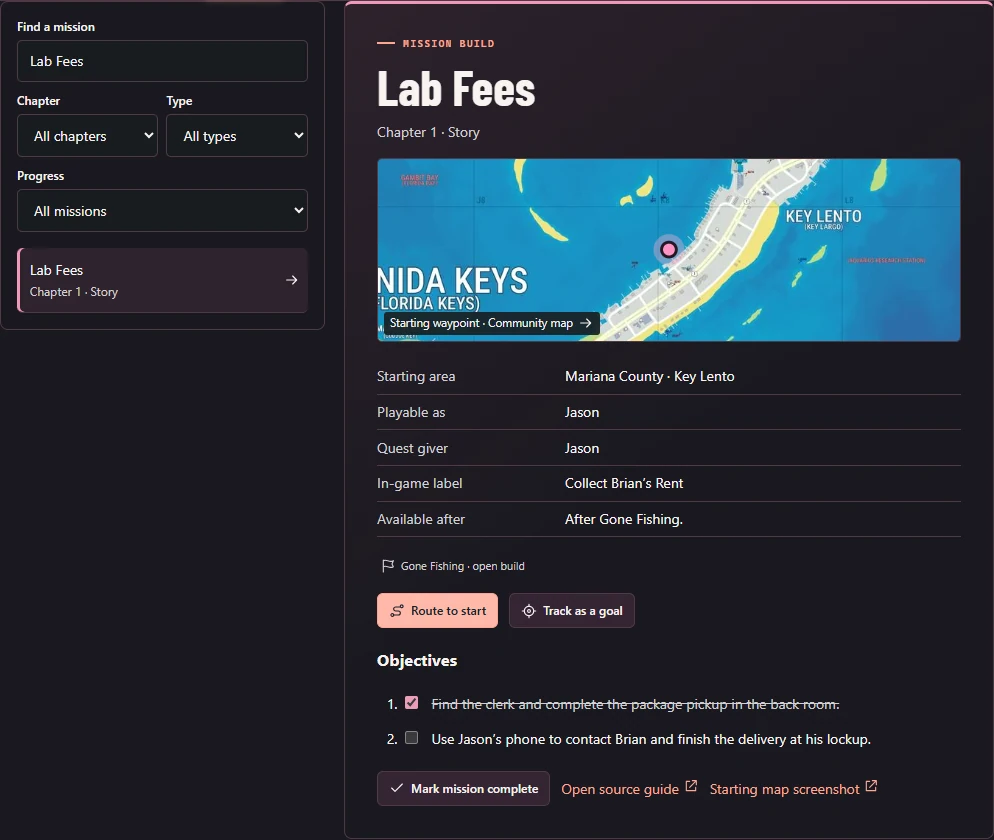

Open **Goals** to track one mission or set a category target, such as three collectibles. Set your chapter and character to narrow down the next stop. Open its instructions or route from your character’s position. A bounty goal stays on your list and shows its shortfall until eligible reports arrive. Your checklist, builds and goals travel together in a journal backup.

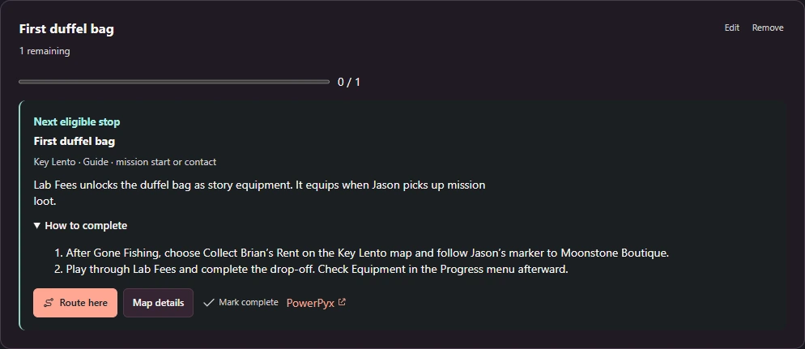

## 3. Follow a route and save your progress

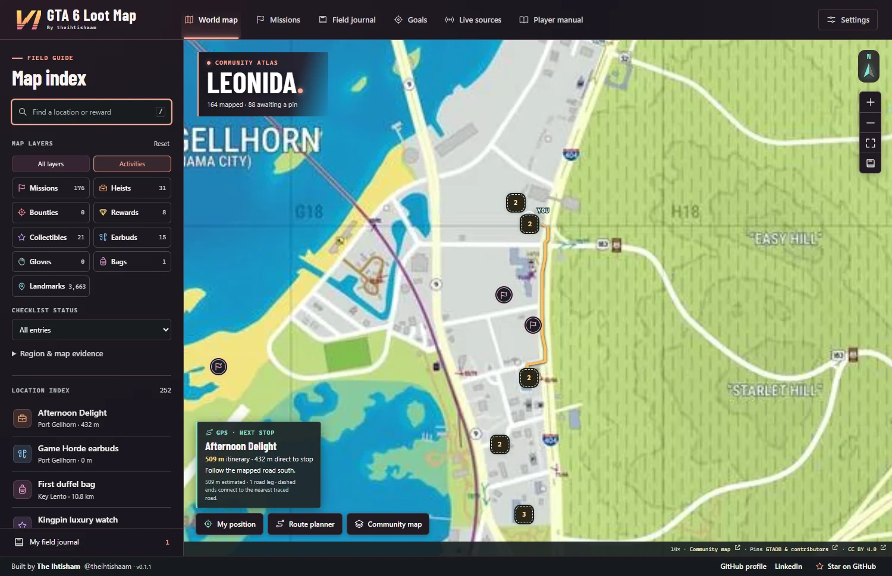

1. In the atlas, choose **My position** and click the location that matches your in-game character. If you’re already at a listed place, open it and choose **Set as my position**.
2. Open your destination and choose **Route here**. The GPS card shows the next stop. Solid lines follow mapped road traces. A dashed line shows an estimated connection or a direct bearing when no road trace connects the points. [How directions are calculated](https://github.com/theihtishaam/GTA-6-Interactive-Map-and-Loot-Tracker/blob/v0.1.3/docs/NAVIGATION.md)
3. As you travel in the game, update your position in the atlas. Use **Route planner → Reached first stop** to advance a multistop route. The optional screenshot locator and coordinate feed are described in [advanced features](https://github.com/theihtishaam/GTA-6-Interactive-Map-and-Loot-Tracker/blob/v0.1.3/docs/ADVANCED.md#optional-positioning).
4. Open **Field journal** to review completed locations, add personal pins and back up your progress. Use **Export center** for a printable field pack or a filtered list.

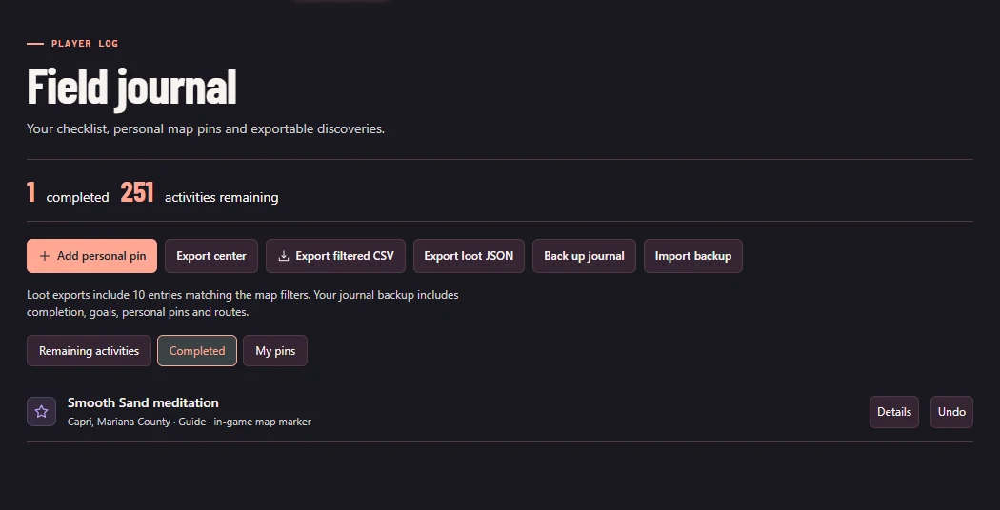

*Use a **journal backup** to move editable progress and routes to a different browser. CSV is for reviewing or sharing a list.*

## 4. Check for new finds

Open **Live sources → All activities** for public reports about heists, gear and rewards. Open **Bounty Watch** for bounty-specific searches. Each defaults to **Every 24 hours** and has its own **Check now** button. Choose 6, 12 or 24 hours and select **Save schedule** to change either one. Both run while the local server is open.

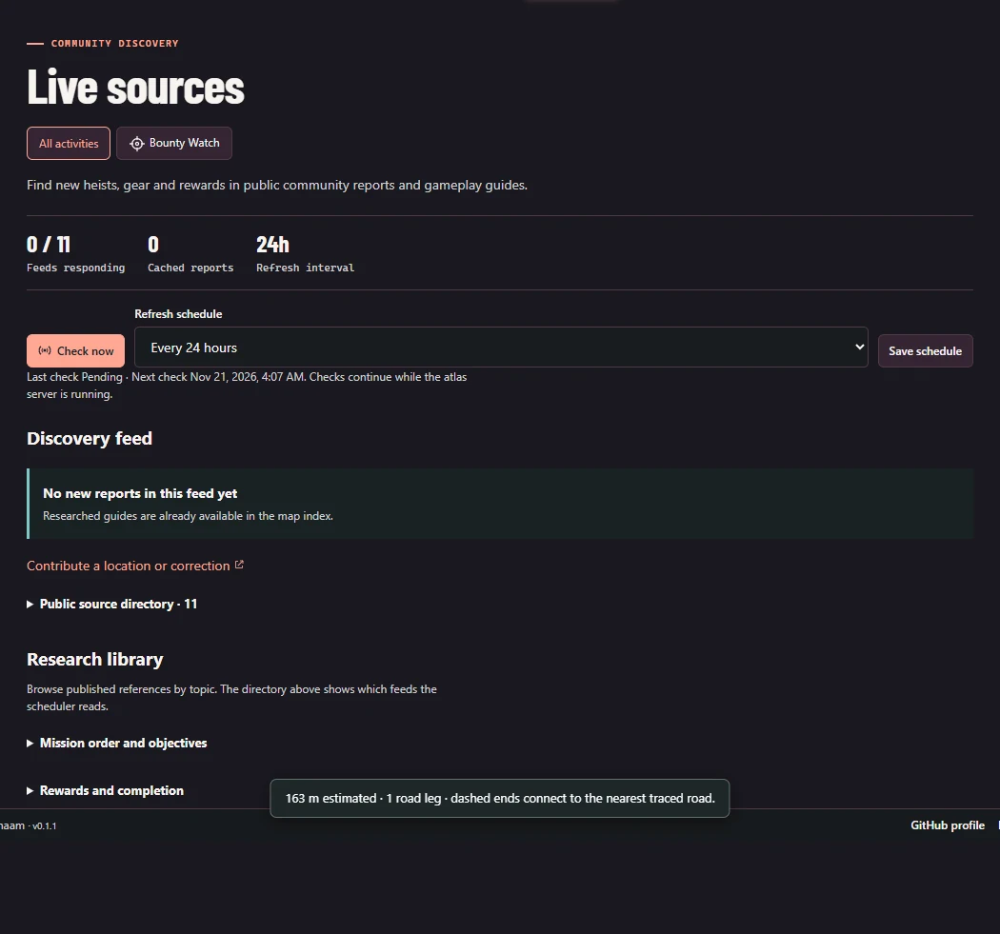

*This is the first-launch view before checks finish. Open a report to check its evidence. Discoveries with uncertain locations stay in the feed without a pin.*

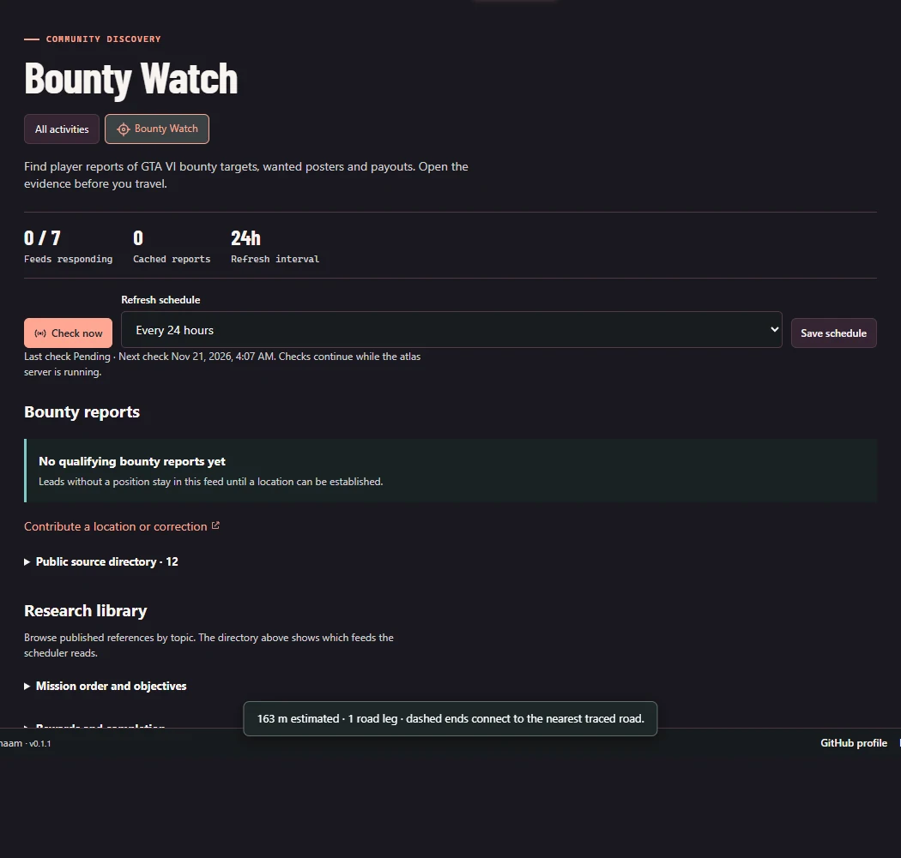

*After a check, zero qualifying reports means the checked sources produced no eligible bounty claims. Open the public directory to inspect the checked feeds or browse a community manually.* [Source discovery and coverage](https://github.com/theihtishaam/GTA-6-Interactive-Map-and-Loot-Tracker/blob/v0.1.3/docs/RESOURCE-DISCOVERY.md) · [Bounty Watch API](https://github.com/theihtishaam/GTA-6-Interactive-Map-and-Loot-Tracker/blob/v0.1.3/docs/API.md)

Every discovered report carries a source. **Corroborated** means independent accounts match a specific activity and location. **Needs review** hides a disputed pin and removes its linked route stop. Choose **Draft a community report** on any entry to write a correction, review it and post it yourself on GitHub. [Evidence rules](https://github.com/theihtishaam/GTA-6-Interactive-Map-and-Loot-Tracker/blob/v0.1.3/docs/EVIDENCE-REVIEW.md)

### Optional AI

Open **Settings** to connect a provider. Ollama Cloud preselects **GPT-OSS 120B** from its live catalogue. Keep it or choose another model before enabling enrichment. For free hosted inference, OpenRouter prefers the free 120B variant when listed and otherwise offers its free router. Local Ollama uses a model already on your computer. Ollama Cloud requires consent to metered use. [Model setup and cost](https://github.com/theihtishaam/GTA-6-Interactive-Map-and-Loot-Tracker/blob/v0.1.3/docs/MODELS.md)

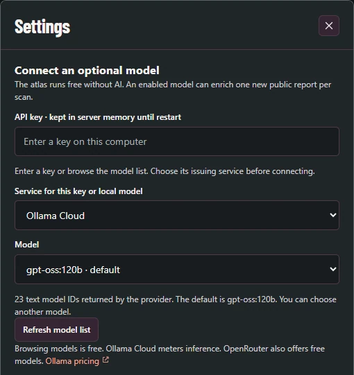

### A first-day routine

Open **Player manual** and start with **First launch**. Pick a landmark you recognize in the game, set your position, and route to one nearby activity. Check it off when you finish, back up your journal, then check **Live sources** or leave the default schedules running in the background.

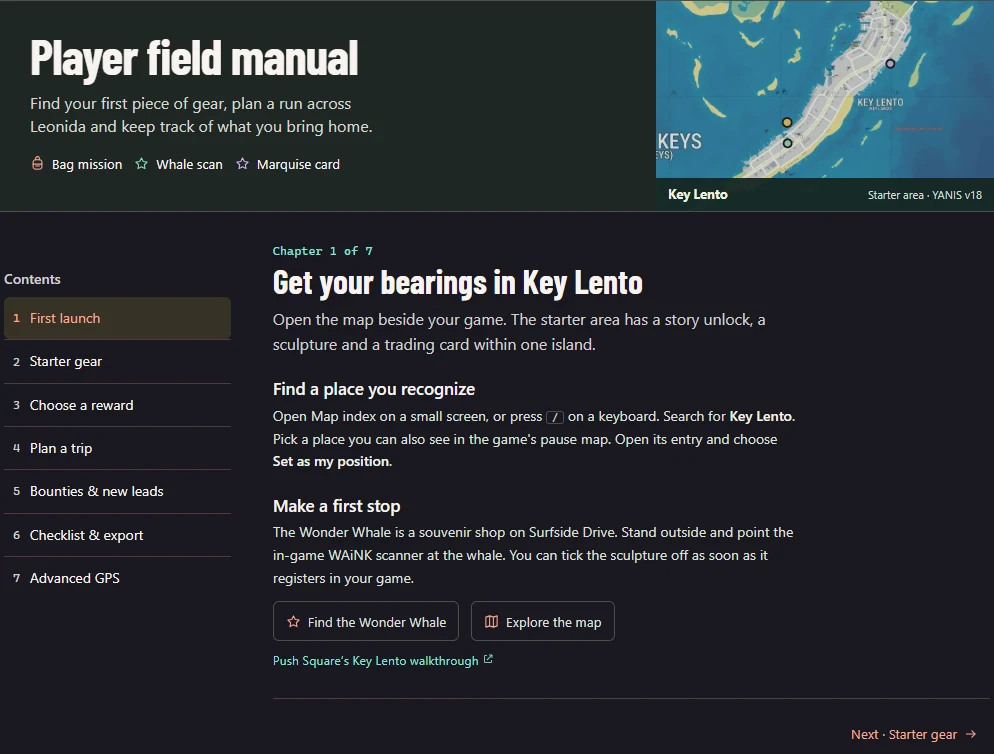

## Sources and credits

- Community cartography by YANIS, GTADB and contributors is adapted under CC BY 4.0. The screenshots above use that bundled map. [Map data and attribution](https://github.com/theihtishaam/GTA-6-Interactive-Map-and-Loot-Tracker/blob/v0.1.3/docs/MAP-DATA.md)
- The illustrated cover and gear spread are original AI-assisted fan art. The dashboard images show the running companion app.
- Guide pins link to their published evidence. An in-game map marker, a venue pin and an area report represent different levels of precision. [Guide research](https://github.com/theihtishaam/GTA-6-Interactive-Map-and-Loot-Tracker/blob/v0.1.3/docs/PLAYER.md) · [Activity-pin evidence](https://github.com/theihtishaam/GTA-6-Interactive-Map-and-Loot-Tracker/blob/v0.1.3/docs/ACTIVITY-PINS.md)
- This independent fan project’s code is MIT licensed. Optional locally downloaded game images remain with their rights holders. [License](https://github.com/theihtishaam/GTA-6-Interactive-Map-and-Loot-Tracker/blob/v0.1.3/LICENSE) · [Developer notes and tests](https://github.com/theihtishaam/GTA-6-Interactive-Map-and-Loot-Tracker/blob/v0.1.3/docs/ADVANCED.md#development)

**Built by The Ihtisham (@theihtishaam).** [GitHub profile](https://github.com/theihtishaam) · [LinkedIn](https://www.linkedin.com/in/ihtishamdeveloper/) · [Star the project](https://github.com/theihtishaam/GTA-6-Interactive-Map-and-Loot-Tracker)

